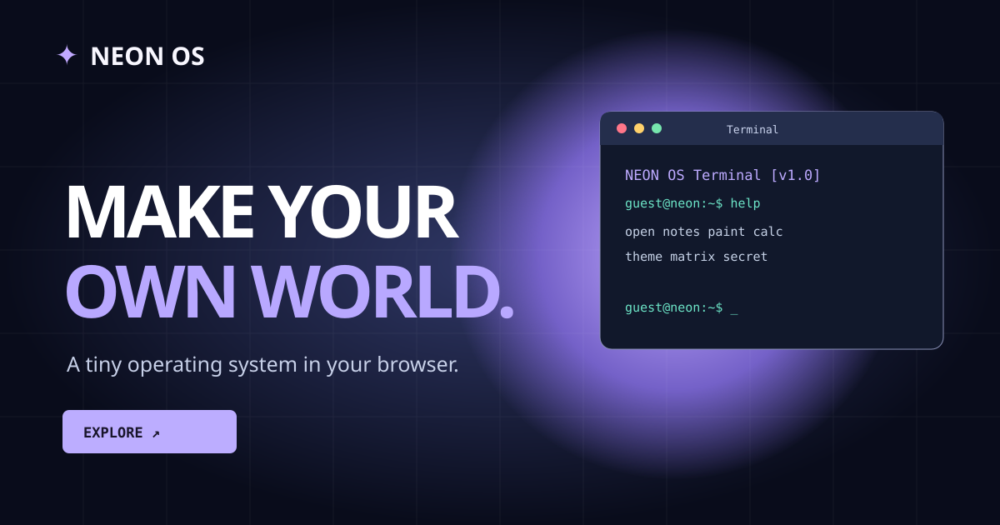

# ✦ NEON OS

**Твоя вселенная прямо в браузере.**

NEON OS это мини-операционная система на HTML, CSS и JavaScript. Здесь есть рабочий стол, приложения, терминал, темы и анимации. Никаких библиотек и серверов для запуска не требуется.



## Возможности

- 🪟 Окна: открытие, закрытие, сворачивание, разворачивание и перетаскивание.
- 💻 Терминал: команды на русском и английском, история ввода, секретные команды.
- 📝 Заметки: автоматическое сохранение в `localStorage`.
- 🎨 Пиксель-арт: рисование на сетке 20 × 14 и экспорт в PNG.
- 🧮 Калькулятор: базовые операции, проценты и смена знака.
- 🌗 Светлая и тёмная темы с сохранением выбора.
- ✨ Плавающие планеты, мерцающие звёзды, живые иконки, плавные окна и эффекты нажатий.
- 📱 Адаптивный интерфейс для компьютера и телефона.
- ♿ Учтена системная настройка уменьшения анимации.

## Запуск

Открой `index.html` в браузере. Устанавливать зависимости не нужно.

## Публикация на GitHub Pages

1. Открой **Settings → Pages** в настройках репозитория.
2. В разделе **Build and deployment** выбери **Deploy from a branch**.
3. Укажи ветку `main` и папку `/ (root)`.
4. Нажми **Save**.

Адрес сайта после публикации: https://raa903004-ops.github.io/neon-os/

## Команды терминала

| Команда | Что делает |
| --- | --- |
| `помощь` / `help` | Показывает список команд |
| `список` / `ls` | Список приложений |
| `открыть заметки` | Открывает заметки |
| `открыть рисовалка` | Открывает рисовалку |
| `открыть калькулятор` | Открывает калькулятор |
| `дата` | Дата и время |
| `ктоя` | Информация о пользователе |
| `эхо Привет!` | Вывод текста |
| `тема` | Переключает тему |
| `очистить` | Очищает терминал |
| `matrix` | Секретная визуализация |
| `secret` | Пасхалка |

Английские команды из предыдущей версии тоже работают.

## Файлы проекта

```text
neon-os/
├── index.html
├── style.css
├── script.js
├── preview.svg
├── LICENSE
└── README.md
```

## Технологии

HTML5, CSS3, JavaScript, Web Storage API, Canvas API.

## Лицензия

MIT. Проект можно изучать, изменять и использовать как основу для собственных идей.
